  

  TechByPixel is an independent technology media and engineering brand exploring the digital world through code, pixel art, animation, and visual storytelling.

## What We Explore

## Connect With Us

  
  
  
  

  

